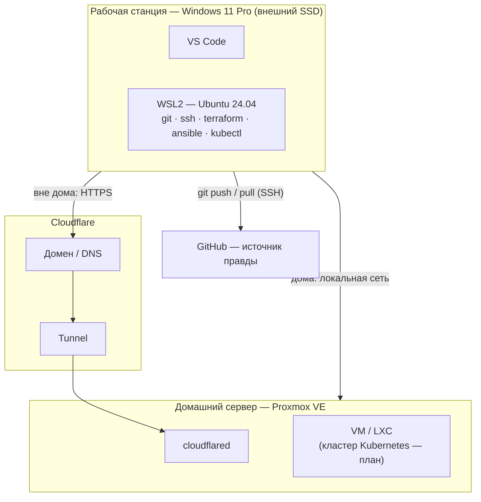

# 0. Общее описание проекта

> **Версия:** v1 · **Дата:** 2026-10-08 · **Статус:** действующий

## 0.1. Назначение

Проект — учебная инфраструктура (homelab) для практического освоения навыков DevOps-инженера и формирования портфолио на GitHub.

**Цели:**
1. Освоить администрирование Linux и виртуализацию (Proxmox VE).
2. Описать инфраструктуру как код (Terraform/OpenTofu, Ansible).
3. Развернуть кластер Kubernetes и приложение в нём.
4. Построить мониторинг (Prometheus, Grafana) и сбор логов (Loki).
5. Настроить CI/CD и GitOps.
6. Вести полную техническую документацию.

## 0.2. Состав системы

| Компонент | Роль | Документ |
|---|---|---|
| Домашний сервер | Полигон: гипервизор, виртуальные машины, кластер | [01](01-hardware.md), [02](02-server-software.md), [03](03-virtual-machines.md) |
| Рабочая станция («ОС-инструмент») | Пульт управления: все инструменты администрирования | [05](05-workstation.md) |
| Cloudflare (туннель, домен) | Удалённый доступ к серверу | [04](04-network.md) |
| GitHub | Хранение кода, конфигураций, документации | [06](06-access-and-security.md) |

## 0.3. Архитектура (черновик)

> Финальные схемы будут построены в конце проекта и размещены в [diagrams/](diagrams/).

## 0.4. Этапы работ

| № | Этап | Статус |
|---|---|---|
| 0 | Чистая Windows 11 Pro на внешнем SSD | ✅ выполнено |
| 1 | Базовое ПО рабочей станции | ✅ выполнено |
| 2 | GitHub, SSH-ключи | ✅ выполнено |
| 3 | WSL2 + Ubuntu 24.04 | ✅ выполнено |
| 4 | VS Code: расширения, связка с WSL | ⏸ приостановлено |
| 5 | Репозиторий проекта, первый коммит | ⏸ приостановлено |
| 6 | Установочные скрипты рабочей станции | ⬜ |
| 7 | Инструменты DevOps (Docker, Terraform, Ansible, kubectl…) | ⬜ |
| 8 | Бэкап образа SSD, BitLocker | ⬜ |
| 9 | Аудит сервера, защищённый доступ | ⬜ (нет доступа к серверу) |
| 10 | Шаблоны VM, Terraform + Ansible | ⬜ |
| 11 | Кластер Kubernetes | ⬜ |
| 12 | Мониторинг и логи | ⬜ |
| 13 | Приложение, CI/CD, GitOps | ⬜ |
| 14 | Финальные схемы и итоговая документация | ⬜ |

Условные обозначения: ✅ выполнено · 🔄 в работе · ⏸ приостановлено · ⬜ не начато.
